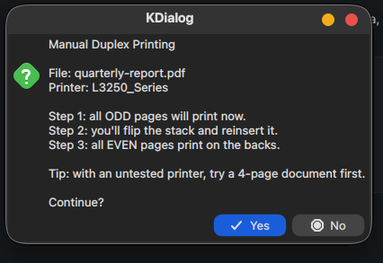
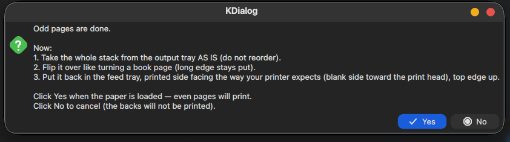
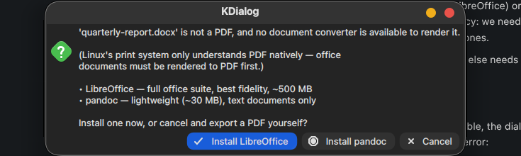

# Manual Duplex Print

A **"fake duplexer wizard"** for Linux — print double-sided documents on
printers that have **no duplex hardware** (e.g. Epson EcoTank L3250 /
ET-2810 and many other budget inkjets).

On Windows, vendor drivers include a *manual duplex* assistant. CUPS has no
such feature, so print dialogs (Okular, Evince, etc.) show the two-sided
option greyed out. `manual-duplex` fills the gap:

1. Prints all **odd** pages
2. Watches the CUPS queue until the printer is physically finished
3. Shows a dialog with **flip instructions** and waits for you to reload the paper
4. Prints all **even** pages on the backs


## Screenshots

<p align="center">
  <br>
  <em>The wizard confirms the file and printer, then prints all odd pages.</em>
</p>

<p align="center">
  <br>
  <em>Once the queue is empty, you get exact flip-and-reload instructions.</em>
</p>

<p align="center">
  <br>
  <em>Missing a converter for a non-PDF file? Install it right from the dialog.</em>
</p>

## Supported file formats

| Format | Converter used | Works without LibreOffice? |
|---|---|---|
| **PDF** | none needed | ✅ |
| **doc / docx / odt / rtf** | LibreOffice → *pandoc fallback* | ✅ with pandoc (except `.doc`) |
| **ppt / pptx / odp** | LibreOffice | ❌ — LibreOffice required |
| **xls / xlsx / ods** | LibreOffice | ❌ — LibreOffice required |
| **md / html / epub / txt** | pandoc | ✅ |
| Anything else | — | Export to PDF from your application first |

Conversion happens automatically and invisibly — you can right-click a
`.docx` exactly the same way as a `.pdf`. The tool tries LibreOffice
first (best fidelity) and falls back to **pandoc** (lightweight, ~30 MB)
for text documents. The converted PDF is temporary and deleted after
printing.

**Missing a converter? The wizard installs it for you.** If you feed it
a non-PDF and neither LibreOffice nor pandoc is present, the dialog
offers *Install LibreOffice* / *Install pandoc* buttons — one click, an
admin password prompt, and the conversion continues automatically.
Works across apt, dnf, zypper, and pacman systems.

*Why is this needed at all?* Linux's print system (CUPS) is PDF-centric:
every job becomes PDF internally, and the odd/even page-splitting
happens in a filter that only understands PDF. Unlike Windows, the print
stack has no built-in renderer for office documents — so a rendering
engine (LibreOffice/pandoc) is required for anything that isn't already
PDF.

> **No LibreOffice? No problem** for PDFs (nothing extra needed) or
> text documents (`sudo apt install pandoc`). Only presentations and
> spreadsheets truly need LibreOffice.

## Installation

### Option 1 — Debian/Ubuntu package (.deb)

Download `manual-duplex-print_1.3.0_all.deb` from the
[latest release](https://github.com/VanguardArts/manual-duplex-print/releases/latest)
and either double-click it, or install from a terminal:

```sh
sudo apt install ./manual-duplex-print_1.3.0_all.deb
```

Remove it later with `sudo apt remove manual-duplex-print`.

### Option 2 — Fedora/RHEL/openSUSE package (.rpm)

Download `manual-duplex-print-1.3.0-1.noarch.rpm` from the
[latest release](https://github.com/VanguardArts/manual-duplex-print/releases/latest):

```sh
sudo dnf install ./manual-duplex-print-1.3.0-1.noarch.rpm   # Fedora/RHEL
sudo zypper install ./manual-duplex-print-1.3.0-1.noarch.rpm # openSUSE
```

### Option 3 — Arch Linux

A `PKGBUILD` is included in [`packaging/`](packaging/PKGBUILD):

```sh
git clone https://github.com/VanguardArts/manual-duplex-print.git
mkdir -p /tmp/manual-duplex-build
cp manual-duplex-print/packaging/PKGBUILD /tmp/manual-duplex-build/
cd /tmp/manual-duplex-build && makepkg -si
```

(Publishing to the AUR proper requires an AUR account — see
[CONTRIBUTING](CONTRIBUTING.md) if you'd like to maintain it.)

### Option 4 — Install script (any distro)

```sh
git clone https://github.com/VanguardArts/manual-duplex-print.git
cd manual-duplex-print
sudo ./install.sh          # or: sudo make install
```

Uninstall with `sudo ./uninstall.sh` (or `sudo make uninstall`).

### What gets installed

- `/usr/local/bin/manual-duplex` — the tool itself
- `/usr/share/applications/manual-duplex.desktop` — app-menu entry and
  *Open With* integration for documents

### Dependencies

- `bash`, CUPS client tools (`cups-client` on Debian/Ubuntu) — required
- `kdialog` **or** `zenity` — recommended for GUI prompts (falls back to
  terminal prompts without them)
- `libreoffice` — optional, only needed for non-PDF office documents
- `pandoc` — optional lightweight alternative converter for text
  documents (docx/odt/rtf/md/html/epub/txt)

  *(Both are installable on demand from the wizard's install buttons —
  see above.)*
- The odd/even page filtering uses the standard `cups-filters` pipeline
  present on virtually all distros — no setup needed

## How to use it

### From your file manager (the easy way)

1. **Right-click** a PDF or office document
2. Choose **Open With → Manual Duplex Print**
   - KDE/Dolphin: right-click → *Open With* → *Other Application…* →
     **Manual Duplex Print** (optionally tick *Remember* to make it stick)
   - GNOME/Files (Nautilus): right-click → *Open With Other Application* →
     **Manual Duplex Print**
3. Follow the on-screen wizard: odd pages print, a dialog tells you how to
   flip and reload the stack, click **Yes**, even pages print on the backs.

You can also launch **Manual Duplex Print** from your app menu with no
arguments — it opens a file picker.

### From the terminal

```sh
manual-duplex document.pdf            # uses the system default printer
manual-duplex report.docx             # office formats work too (needs LibreOffice)
manual-duplex -p L3250_Series doc.pdf # pick a specific CUPS queue
manual-duplex --short-edge doc.pdf    # short-edge flip instructions
```

Set a persistent printer via the environment:

```sh
export DUPLEX_PRINTER=L3250_Series
```

### Tips

- **Test the flip orientation first** with a short (4-page) document.
  Paper path differs between printers (rear feed vs. cassette), so check
  that page 2 lands correctly behind page 1 before printing something long.
- Keep the stack **in order** when reloading — the even pages are printed
  assuming you flipped the stack as-is.
- If page 2 comes out upside-down or misordered, try `--short-edge` or
  flip the stack the other way — then open an issue so we can add your
  printer's quirk to the docs.

## How it works

Nothing exotic: it submits two CUPS jobs with `-o page-set=odd` /
`-o page-set=even` (handled by `cups-filters`' `pdftopdf`), converts
non-PDF input with headless LibreOffice/pandoc, and uses desktop dialogs
for the wizard steps. A single dependency-light bash script — no daemon,
no background service.

### Job-completion detection (the careful part)

An empty queue does **not** guarantee the printer has physically finished.
The tool therefore uses three phases, with a human confirmation as the
final safety net:

1. **Tracks its own job ID** (not the whole queue), so other users' jobs
   on a shared printer can't confuse it.
2. **Distinguishes completion from cancellation** — a job that vanishes
   from the active list without reaching the completed collection triggers
   a warning dialog instead of silently proceeding.
3. **Waits for the printer to report physically idle** (USB backends like
   Epson's report busy/printing state) before showing the flip dialog —
   plus the dialog itself requires you to confirm the pages are actually
   in the tray before the backs are printed.

## Known limitations / edge cases

- **Multiple copies** are forced to 1 (`copies=1`) — collated multi-copy
  odd/even interleaving is a footgun. For N copies, run the wizard N times.
- **Paper-feed orientation varies by printer** (rear feed vs. cassette).
  The flip instructions match the common rear-feed case; test with a
  4-page document first, and report your printer's quirk as an issue.
- **Printers that don't report busy/idle state** fall back to a timeout;
  the flip dialog's human confirmation covers the residual race.
- **Odd total page counts**: CUPS emits no blank trailing even page, so
  the last odd page simply gets no back — usually what you want, but
  keep it in mind when reinserting the stack.

## Contributing

Issues and pull requests welcome — especially printer-specific flip
instructions, translations of the dialog text, and packaging for more
distros (.rpm, Flatpak, AUR).

## License

GPL-3.0-or-later. See [LICENSE](LICENSE).

## Vanguard Arts

- **Website:** https://vanguardarts.vip/
- **Support:** [https://vanguardarts.vip/contact](https://vanguardarts.vip/contact)
